# Radio Tutor: a tutorial for parents

Radio Tutor is a program for your computer that tutors a child with short animated lessons. A lesson is a picture that moves while a narrator explains it, with captions underneath. After each lesson the child gets a worksheet, solves it **on paper**, and takes a photo of the page with a phone. An AI model looks at the photo, tells the child which answers are right and why, and unlocks the next lesson when the whole worksheet is passed. You, the parent, stay in charge: you create the child's account, choose the AI, see every photo and can overrule the AI.

This tutorial walks through everything with screenshots, in the order you will meet it:

1. [Install and start](#1-install-and-start)
2. [Parent setup](#2-parent-setup): your account, the child's account, the AI, the first cassette, settings and the phone
3. [Making a cassette with an AI agent](#3-making-a-cassette-with-an-ai-agent)
4. [The child's session](#4-the-childs-session): from the login to the results
5. [The parent afterwards](#5-the-parent-afterwards): progress, photos and reviews
6. [Troubleshooting and tips](#6-troubleshooting-and-tips)

The lessons in the screenshots are two real example cassettes in Greek (fifth-grade physics, "Υλικά σώματα" and "Μίγματα και διαλύματα"), with a real child's real progress, so the lesson texts and the AI's feedback are in Greek while the program's own buttons are in English. Radio Tutor itself can be switched between English and Greek (see [Settings](#27-settings)). The photos of the child's notebook are real too. So that no real AI service was called while taking the screenshots, the part of section 4 from the photo upload to the results was run with a stand-in for the AI that replayed one of the real answers (it is said again where that happens). The worksheet, the QR screen and the phone page of section 4 were taken on a copy of the data in which the child's progress in the first cassette had been cleared, so that the first worksheet was open.

## 1. Install and start

Radio Tutor runs on Linux and on Windows 10 and 11. The full instructions (what you need, how to install, the Windows details) are in the [README](../README.md); in short, on Linux:

```
go install github.com/rm4n0s/radio-tutor/cmd/radio-tutor@latest
radio-tutor
```

You also need a phone with a camera on the same Wi-Fi as the computer, and an AI provider (a cloud service with your own key, or a program such as Ollama on your own computer).

## 2. Parent setup

### 2.1 Create the parent account

The first time Radio Tutor starts, it asks for the parent account. Choose a username (lowercase letters a to z, digits and `_`), the name that should be shown, and a password of at least 8 characters. This account becomes the first parent (an "admin"). The small **EN** and **ΕΛ** buttons at the top switch the language of the program.

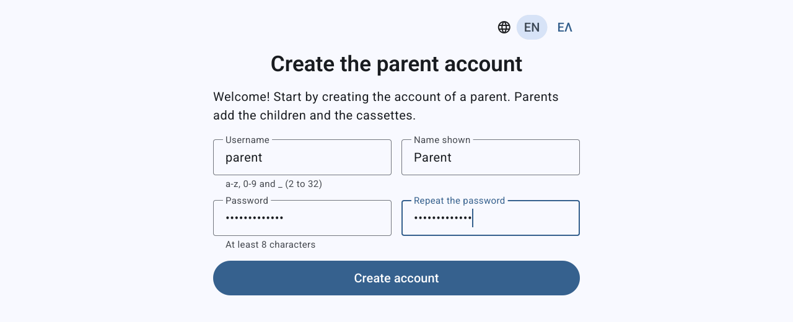

The next time you start the program you pick your name on the login screen and type your password. If you ever forget it, the [README](../README.md#forgotten-password) explains how to reset it from a terminal.

### 2.2 The parent home

After you log in, you see the parent area with six tiles: **Students** (children's accounts), **Cassettes** (the lessons), **Progress** (what the children did, with the number of exercises waiting for you), **Settings**, **AI providers** and **Play as me** (try the lessons yourself). **Log out** is at the top right.

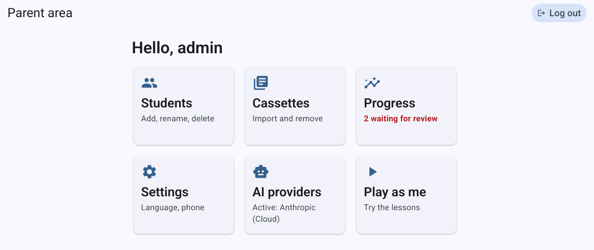

### 2.3 Add a student

Open **Students**. The list shows everybody who has an account, with a **Parent** or **Student** label. For each person the icons let you rename them, reset their password, choose which cassettes they may see (the eye, for students) and delete the account (deleting a student also deletes their progress and photos, after a confirmation).

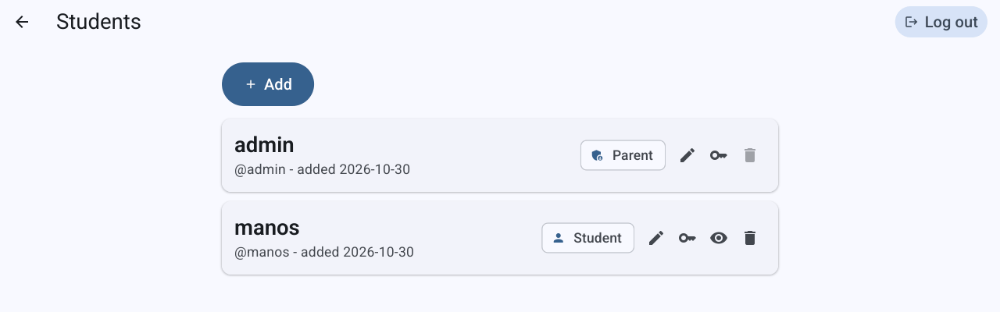

Press **Add**, type a username and a name for the child, and choose a password of at least 4 characters (children need only 4; parents need 8). Leave **Account type** on **Student**. The child will tap their name on the login screen and type this password.

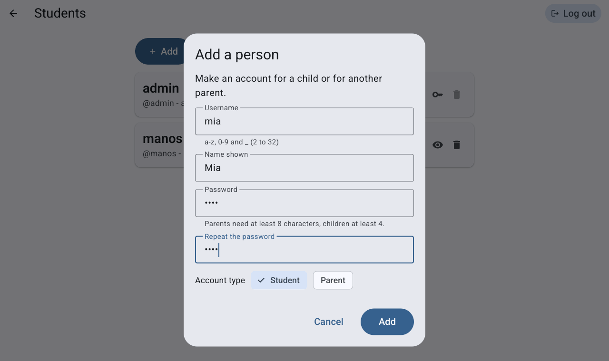

### 2.4 Set up the AI provider

Radio Tutor does not grade the photos itself: it sends them to an AI model that can read images. Open **AI providers**. The note at the top says what matters:

- A **cloud** provider (OpenAI, Gemini, Anthropic, OpenRouter) receives the **photos of the child's paper and the text of the exercises** over the internet. It needs an API key that you get from the company. Read its privacy rules first.
- A **local** provider (Ollama, LM Studio, llama.cpp server) keeps the photos on your computer or your home network and needs no key. It is slower, and how well it reads handwriting depends on the model.
- Either way, the name of the child is never sent.

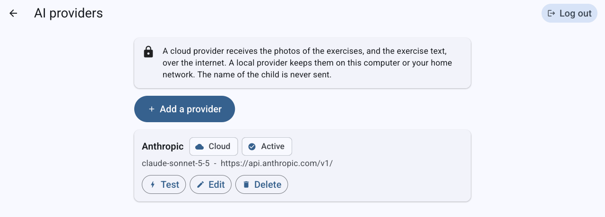

Press **Add a provider** and pick a preset; it fills in the address and an example model, and you edit what you need. Here is the **Ollama** preset, the usual choice for working offline (first run `ollama pull qwen2.5vl:7b` and make sure Ollama is running; the [README](../README.md#choosing-an-ai-provider) has the details):

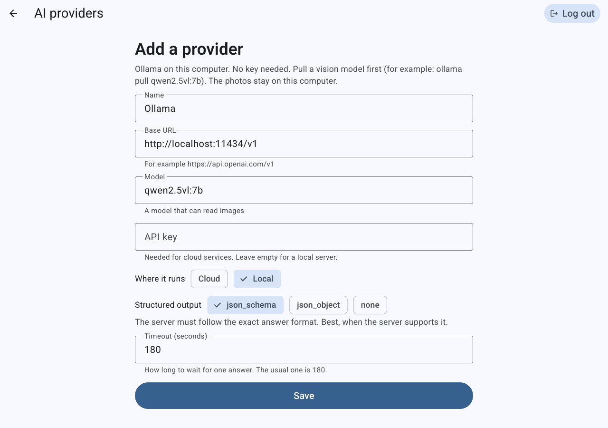

Then, on the provider's card:

1. Press **Test**. Radio Tutor sends a small picture of "2 + 3 = 5" and tells you whether a good answer came back, how long it took and which model answered. Fix the address, key or model until it says "It works."
2. Press **Set active**. The first provider you add is not active automatically, and until one is active the exercises cannot be checked. The home screen shows which one is active and whether it is cloud or local.

Your API key is stored in a file that only you can read (`providers.json`). If that file is readable by other users the program refuses to use it and tells you to run `chmod 600` on it.

### 2.5 Import a cassette

A **cassette** is a single `.cassette` file with the lessons and exercises of one subject. Open **Cassettes** and press **Import a cassette**; your desktop's file chooser opens, and you pick the file. The program checks the whole cassette first: if anything is wrong it lists the problems and installs nothing. To try the program you can use `testdata/cassettes/sample.cassette` from the repository ("Halves and quarters", in English). How to make your own is in [section 3](#3-making-a-cassette-with-an-ai-agent).

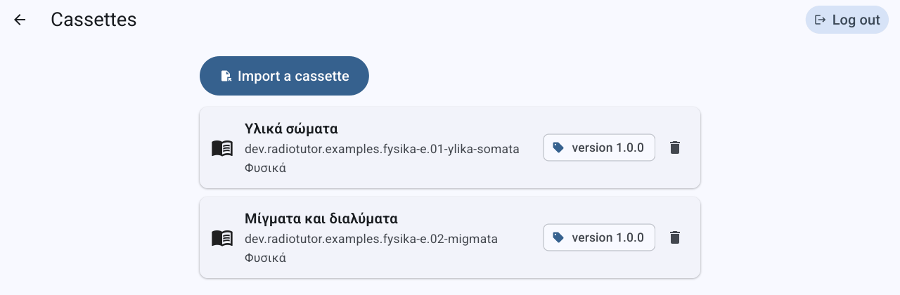

Importing a newer version of a cassette you already have keeps the child's progress; importing the same version again just says it is already installed. The trash icon removes a cassette (the progress and photos stay unless you also tick the box that deletes them). Students can import cassettes too, unless you switch that off in Settings.

### 2.6 Look at it yourself first

Before the child sees a new cassette, press **Play as me** on the home screen. It is the child's view with your own progress, so you can try a lesson and a worksheet. You can see it in [section 5.5](#55-play-as-me).

### 2.7 Settings

**Settings** has four groups:

- **Language** of the program: English or Greek.
- **Importing cassettes**: whether students may import cassettes themselves.
- **Volume** and **Mute the sound**: for the lessons and the spoken exercises, for everybody. Children can change the same two things in the lesson player.
- **Phone**: the **port** on which the computer serves the photo page to the phone (8737 unless that is taken), and, if the computer has several networks, which **network interface** to use.

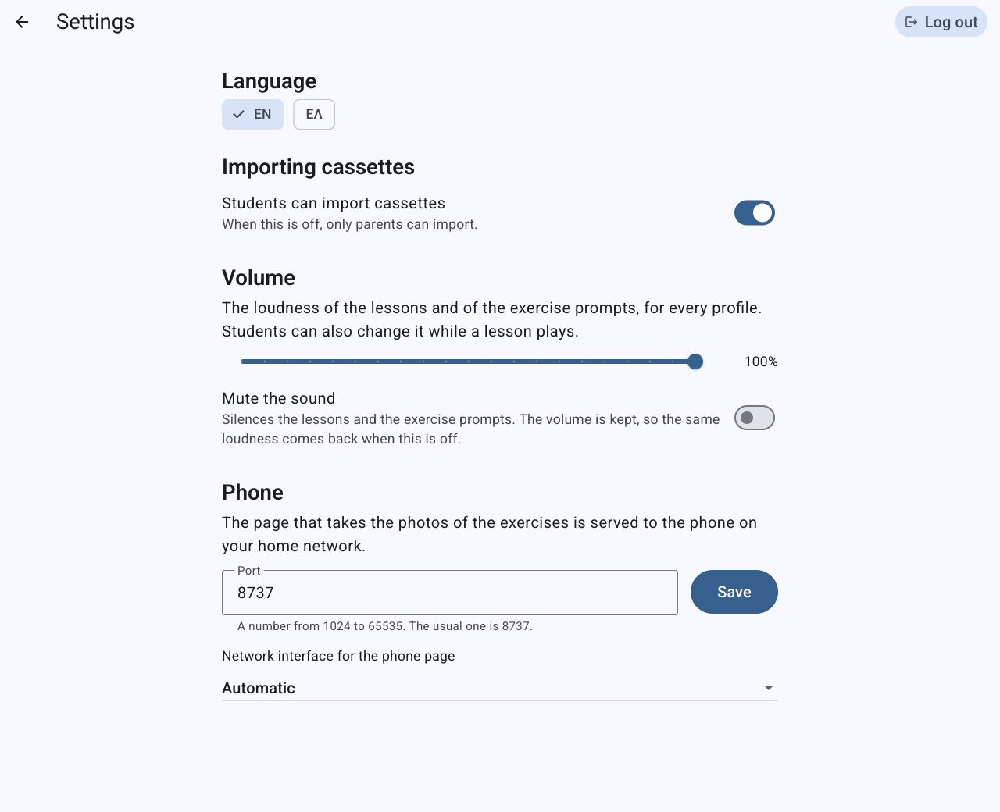

### 2.8 Let the phone reach the computer

The computer serves a small web page to the phone, on your home network only. A firewall can block it. On **Windows**, the first time the page starts, Windows asks whether Radio Tutor may use the network: allow it on **private networks**. On **Linux** you may need to open the port once. With firewalld (Fedora and others):

```
sudo firewall-cmd --add-port=8737/tcp --permanent && sudo firewall-cmd --reload
```

With ufw (Ubuntu and others): `sudo ufw allow 8737/tcp`. Use your own number if you changed the port in Settings. If the phone cannot open the page, the screen with the QR code reminds you of this after a minute (see [section 4.5](#45-check-my-answers-and-the-phone)).

## 3. Making a cassette with an AI agent

You do not write cassettes by hand. You give an **AI agent that can work with files and run commands on your computer** (for example Claude Code, or another coding agent) your book or subject and a ready-made prompt. The agent writes the lessons, draws the pictures, makes the narration with a text-to-speech program and packs everything into a `.cassette` file.

### 3.1 What you need

- An AI agent that can create files and run commands in a folder. A plain chat window is not enough, because the narration audio has to be produced and measured.
- `ffmpeg` (with Vorbis support) and a text-to-speech program: `espeak-ng` (on most Linux systems; sounds robotic) or `piper` (much more natural, with voices for many languages). You can also record the narration with your own voice (see the end of the prompt page).
- The `radio-tutor` program, to check and pack the cassette. Run `radio-tutor version` to see that it is installed.
- The material: a chapter of a book (PDF, photos of the pages or typed text), or just a subject and what the child should learn.

The material stays on your computer and with the AI provider your agent uses. Use books you own for your own family, and don't share cassettes made from copyrighted books.

### 3.2 The steps, in plain words

The full prompt is in [docs/CASSETTE-AUTHORING-PROMPT.md](CASSETTE-AUTHORING-PROMPT.md); copy it from there. This is what you do:

1. Make an empty folder, put the material in it (for example `source/chapter-12.pdf`) and start the agent in that folder.
2. Copy the prompt, replace every `{{...}}` with your own answer (an example follows) and give it to the agent.
3. Wait. The agent works through the same steps each time: it reads the material and writes a plan; writes the narration as short sentences (one caption each); turns each sentence into audio and measures the time of every sentence; draws one picture (`scene.svg`) per lesson, with the parts that move kept separate; writes the timeline that moves them while the narrator talks about them; writes the exercises with the right answers, the grading instructions and one to three hints; writes the cassette's manifest and its cover; runs `radio-tutor validate` until it prints no problem; runs `radio-tutor pack`; and finally checks its own work.
4. At the end the agent tells you the path of the `.cassette` file, the list of lessons and exercises, the total narration time and anything it left out or was unsure about.
5. Import the file ([section 2.5](#25-import-a-cassette)) and **watch the first lesson yourself before your child does**.

To change something later, ask the same agent ("make the second lesson slower", "add two harder exercises after lesson 3"). It must raise the cassette's version and keep the ids of what did not change, so your child's progress is kept.

### 3.3 An example of the answers

The example cassette "Υλικά σώματα" was made with this prompt. These are answers that fit it, as you can read them from its own `cassette.json`, lessons and exercises (the cassette says it is based on a chapter of the fifth-grade physics book «Φυσικά Ε΄ Δημοτικού – Ερευνώ και Ανακαλύπτω»; the sentences about the child and the tone below are worded from what the cassette teaches and how its grading instructions speak, not copied from a record of what was typed):

| Placeholder | A matching answer |
|---|---|
| `{{SOURCE}}` | the chapter "Υλικά σώματα" of the fifth-grade physics book «Φυσικά Ε΄ Δημοτικού – Ερευνώ και Ανακαλύπτω», in `source/` |
| `{{GOALS}}` | explain what matter and molecules are, tell solids, liquids and gases apart, and know and measure the three basic properties of a body: volume, mass and density |
| `{{AGE}}` | 10 to 11 |
| `{{LEVEL}}` | fifth grade of primary school |
| `{{LANGUAGE}}` | `el` |
| `{{NUMBER_OF_LESSONS}}` | 4 |
| `{{EXERCISES_PER_WORKSHEET}}` | 3 or 4 |
| `{{TONE}}` | simple, warm Greek, in the singular, like a friendly teacher: praise the effort first, even when the answer is wrong, then say in one or two sentences what to look at again; never tell the child they are bad at physics |
| `{{NOTES}}` | accept every correct equivalent form (7,8 or 7.8; grams or g; cubic centimetres or cm³ or mL); a missing unit makes an answer at most partly right; hand-drawn pictures are not exact, so judge the idea and not the lines; use your own words and drawings, not the book's; if something on the photo cannot be read, say so politely and ask for a clearer photo |
| `{{CASSETTE_ID}}` and `{{VERSION}}` | `dev.radiotutor.examples.fysika-e.01-ylika-somata` and `1.0.0` |
| `{{TTS}}` | the text-to-speech program you have installed, with a Greek voice (for example `espeak-ng -v el`, or `piper` with a Greek voice) |
| `{{RADIO_TUTOR}}` | `radio-tutor` |

The result is four lessons of about two minutes each ("Τι είναι η ύλη;", "Όγκος", "Μάζα", "Πυκνότητα"), each followed by a worksheet of three or four exercises (fifteen exercises in all).

### 3.4 What is inside a cassette

A `.cassette` file is a zip with this layout (the full definition is in [docs/CASSETTE-FORMAT.md](CASSETTE-FORMAT.md)); you never need to open it yourself:

```
cassette.json                  the title, the language, the order of lessons and exercises, the grading instructions
cover.svg                      the cover shown on the shelf
lessons/<lesson-id>/
    lesson.json                the captions and the timeline that moves the picture
    scene.svg                  the picture of the lesson
    narration.ogg              the narrator's voice
exercises/<exercise-id>/
    exercise.json              the question, the right answer, how to grade, the hints
    prompt.svg                 optional: a picture for the exercise
    prompt.ogg                 optional: the exercise read aloud
```

The **cover** is a small picture, and the shelf shows it on the cassette's card:

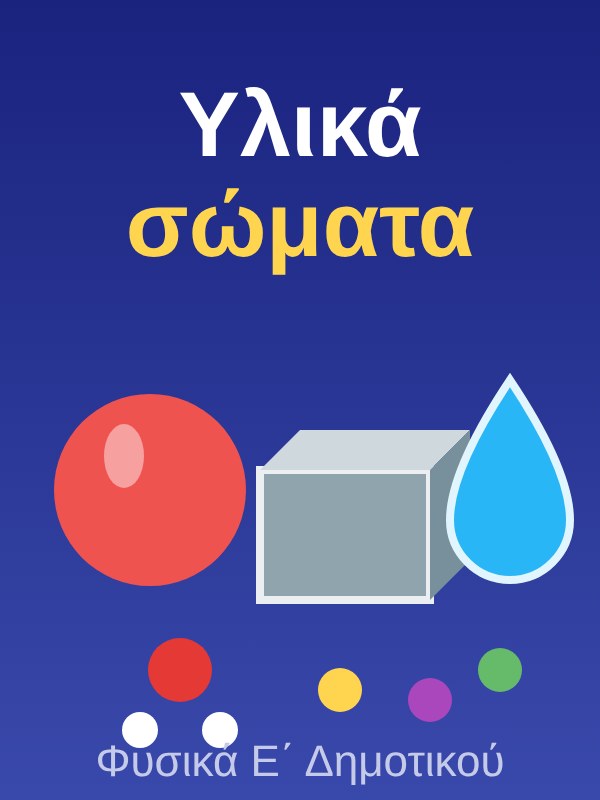

A **lesson** is one big picture whose parts appear and move while the narrator talks, with the words of the narrator as captions. Here is the lesson "Τι είναι η ύλη;" at the moment when the narrator says, "The molecule of water has two atoms of hydrogen and one atom of oxygen" and the picture zooms in on the molecule (this and the other lesson pictures are what the lesson player draws on the screen):

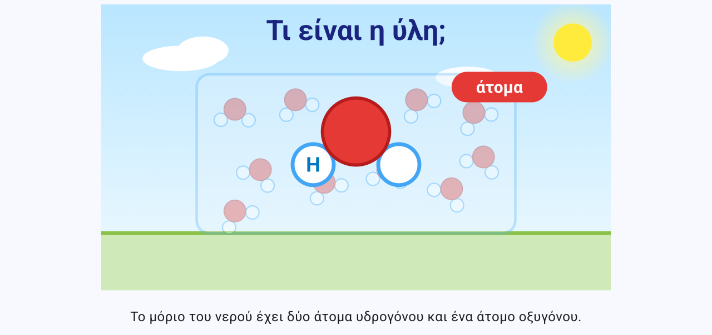

An **exercise** can have a picture too. This one shows a measuring cylinder before and after a stone is dropped into it, and asks for the volume of the stone:

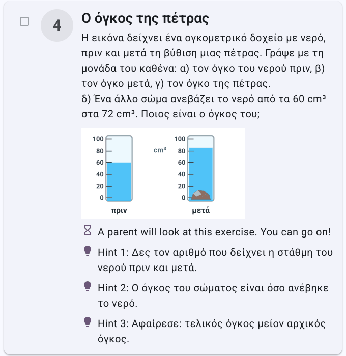

### 3.5 Check and pack

The agent runs these two commands for you, and you can run them yourself at any time, from a terminal. `validate` accepts a folder or a `.cassette` file and prints one problem per line; when there is no problem it says so. This is the real output for the example cassette's folder:

```
$ radio-tutor validate fysika-e-ylika-somata
fysika-e-ylika-somata is valid (0 errors, 0 warnings)
```

When something is wrong, each problem is printed as `path: message`, and the command ends with a count (here a copy of the cassette with a lesson's narration deleted and two exercises given the same label):

```
$ radio-tutor validate fysika-e-ylika-somata
exercises/zografise-ta-moria/exercise.json#label: "1" is already the label of exercise "stereo-ygro-aerio"; labels are unique in a cassette
lessons/maza/narration.ogg: is missing
fysika-e-ylika-somata is not valid (2 errors, 0 warnings)
```

`pack` checks the folder the same way and then writes the file. It will not overwrite an existing file unless you add `--force` (use that when you make a new version):

```
$ radio-tutor pack fysika-e-ylika-somata dev.radiotutor.examples.fysika-e.01-ylika-somata-1.0.0.cassette
Packed fysika-e-ylika-somata into dev.radiotutor.examples.fysika-e.01-ylika-somata-1.0.0.cassette

$ radio-tutor pack fysika-e-ylika-somata dev.radiotutor.examples.fysika-e.01-ylika-somata-1.0.0.cassette
radio-tutor pack: the output file already exists; use force to replace it

$ radio-tutor pack --force fysika-e-ylika-somata dev.radiotutor.examples.fysika-e.01-ylika-somata-1.0.0.cassette
Packed fysika-e-ylika-somata into dev.radiotutor.examples.fysika-e.01-ylika-somata-1.0.0.cassette
```

The result of this example is a file of 1.7 MB. Import it with **Cassettes**, **Import a cassette** ([section 2.5](#25-import-a-cassette)). On Windows use `radio-tutor-cli.exe` for these commands.

## 4. The child's session

### 4.1 Log in

On the login screen the child taps their name and types their password. (The names on this screen are the real ones of the family whose data was used for the screenshots.) The program remembers no password, and only one person is logged in at a time. After five wrong passwords for a name, that name has to wait 30 seconds.


### 4.2 The shelf

The shelf shows every cassette the child may see, as a card with the cover, the title, the subject and a progress bar ("7 of 19 done" counts the passed exercises and the finished lessons). **Import a cassette** is there when students may import. **Log out** is at the top right.

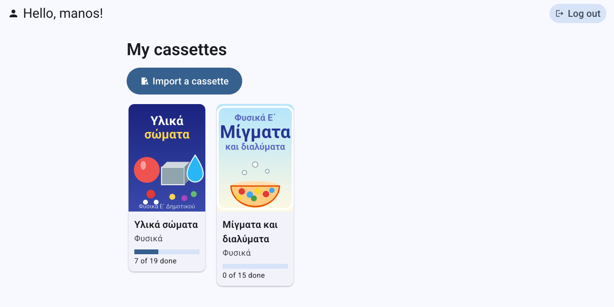

### 4.3 The cassette screen

Tap a cassette to see its lessons and worksheets in order:

- a lesson has a play icon, and a check mark once the child has watched it to the end;
- a worksheet is one row with the numbers of its exercises: a check mark means passed, an hourglass means **a parent will look at this** (see [section 5](#5-the-parent-afterwards)) and a lock means not available yet;
- locked rows are grey. Tapping one only says "Finish the items before this one first." The next lesson unlocks when the whole worksheet before it is passed (or waiting for a parent: an exercise that needs a parent does not hold the child back);
- **Continue** opens the place where the child stopped.

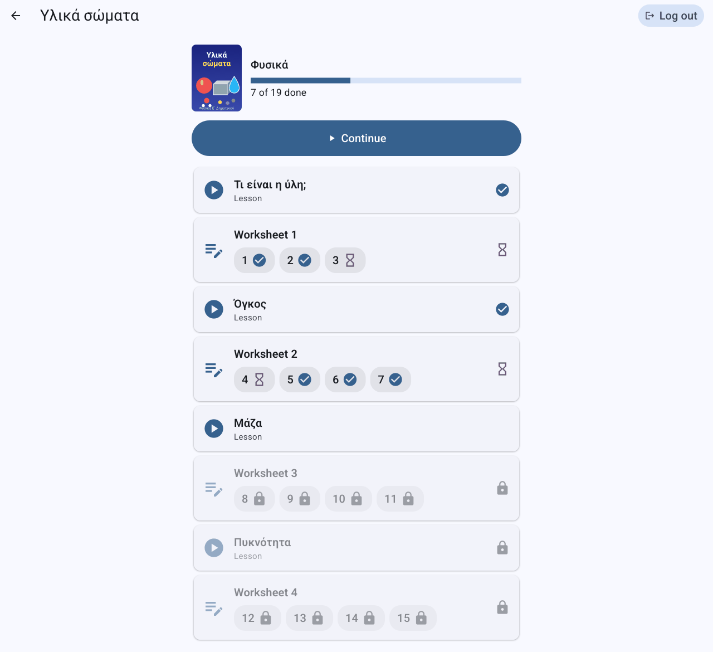

### 4.4 The lesson, and the worksheet

In the lesson player the picture moves while the narrator speaks, and the caption of the sentence being spoken is shown under the picture. There are **Play** (it becomes **Pause**) and **Stop**, a speaker button to mute and a volume slider. The bar shows the time. The child cannot drag the bar. The Escape key goes back. When the narration ends, the lesson counts as finished, and a **Next** button appears.

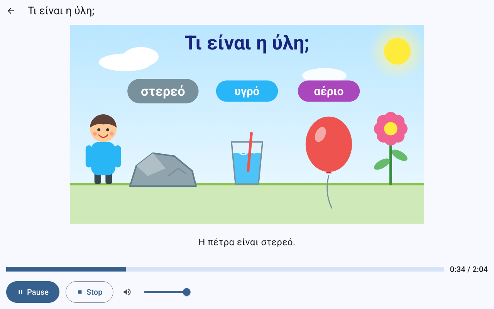

**Next** opens the worksheet. It shows every exercise as a card with a big number (the **label**), a title, the question and, when there is one, a picture. The blue banner says what to do: **solve the exercises on paper and write the number of each exercise next to its solution.** The number is how the AI knows which answer belongs to which exercise. Under the question the card shows the tries left and any hints the child has earned. Every exercise that can be checked is ticked; untick the ones the child is not ready to send. At most ten exercises go in one check.

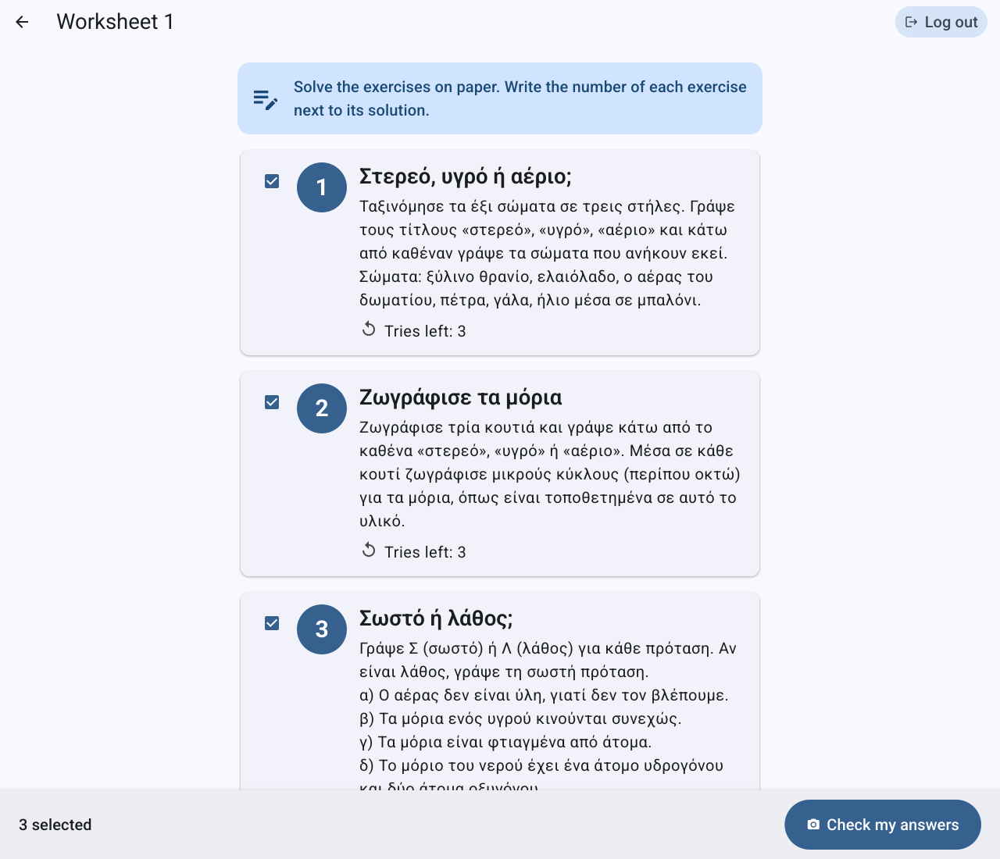

### 4.5 Check my answers, and the phone

When the child presses **Check my answers**, a screen with a **QR code** opens. The child scans it with the phone and opens the page, which is served by the computer on your home network. The address is also written under the code, in case the code cannot be scanned.

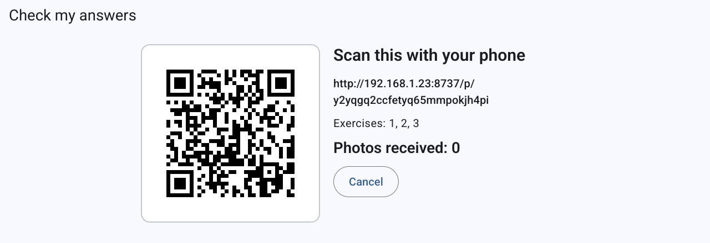

The page on the phone lists the exercises to photograph. The child writes the solutions on paper, takes one or more photos (up to six) with the big **Take photos of the solution** button and presses **Send**. Here is the page in its three states; the screenshots were taken with a phone-sized browser window connected to the real page of the program:

- **waiting**, when nothing is waiting to be photographed;
- **ready**, with the exercises, and under them the button for photos and **Send**, which is grey until there is a photo;
- after the photo was added and sent, **"Sent! Look at the computer."**

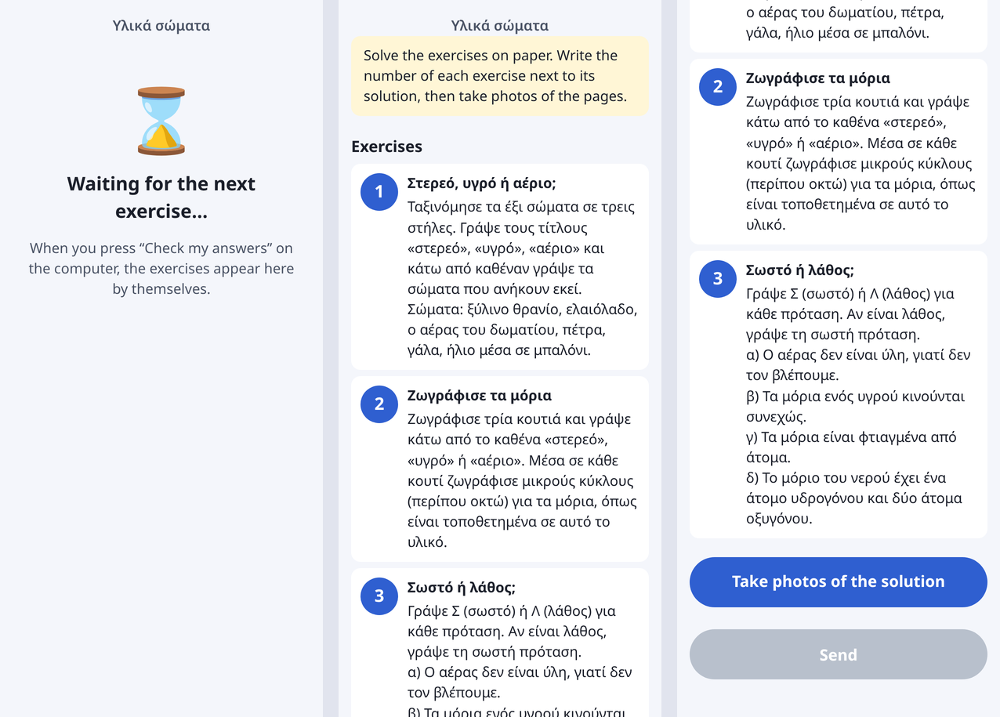

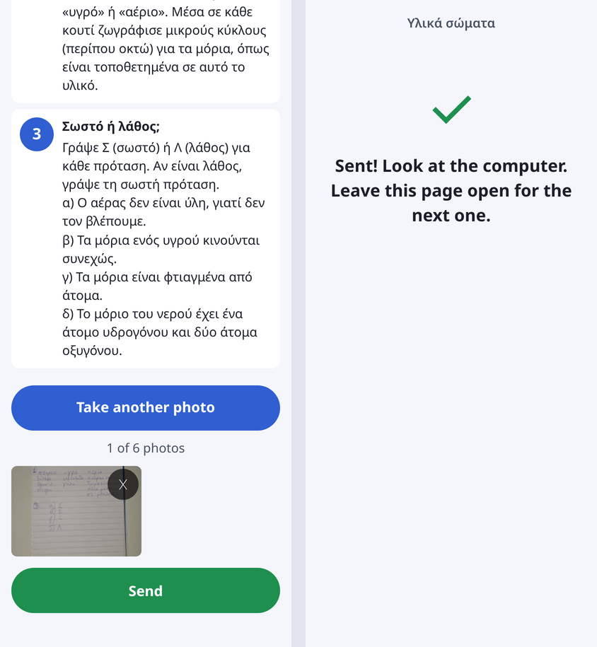

**The phone is connected once per login.** The page stays open, and the next time the child presses **Check my answers** it switches to the new exercises by itself, so the code is scanned only once. The link stops working when the child logs out, when Radio Tutor is closed, or after an hour without photos. If the child presses **Cancel** on the computer, the page goes back to waiting. A check waits 30 minutes for its photos.

If no phone has opened the page a minute after the QR code appeared, the screen reminds you to check that the phone is on the same Wi-Fi and to open the port in the firewall ([section 2.8](#28-let-the-phone-reach-the-computer)).

### 4.6 The AI checks the photos

As soon as the photos arrive, the computer sends them with the exercise texts to the active AI provider and shows "Checking your answers...". This can take a minute. (In the screenshots, from the photos on, the AI was a stand-in that replayed a real earlier answer for the same photo and the same exercises, so the child's feedback you see is real text; the computer part and the photos are the real program.)

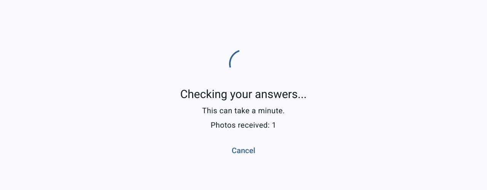

### 4.7 The results

For each exercise the child sees a big mark and the AI's message in the child's own language: a green check for correct (with a star when the exercise is now passed), a **~** for partly right, a red cross for incorrect, and a **?** when the AI could not read the solution or did not find it on the page. After a try that did not pass, the next hint of the exercise is shown. **Back to the worksheet** returns to the exercises, which now show what was passed and how many tries are left.

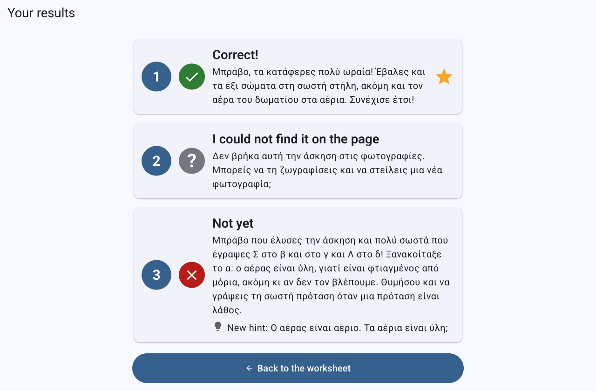

An exercise can be tried as many times as the cassette allows (three in the example cassettes). After the last try, the exercise is marked **A parent will look at this exercise. You can go on!** and waits for you; the child can continue with the next lesson in the meantime.

If the checker cannot answer (no internet, a wrong key, a model that is not running), the child sees "The checker could not answer. Try again." and a **Try again** button, which checks the same photos again without taking new ones.

### 4.8 A finished worksheet

When every exercise of a worksheet is passed or waiting for a parent, the bar at the bottom says **You finished this worksheet!** and offers **Next**, which opens the next item of the cassette. On the last worksheet of a cassette the button is **Done** and goes back to the cassette screen. A worksheet that is not finished keeps **Check my answers**.

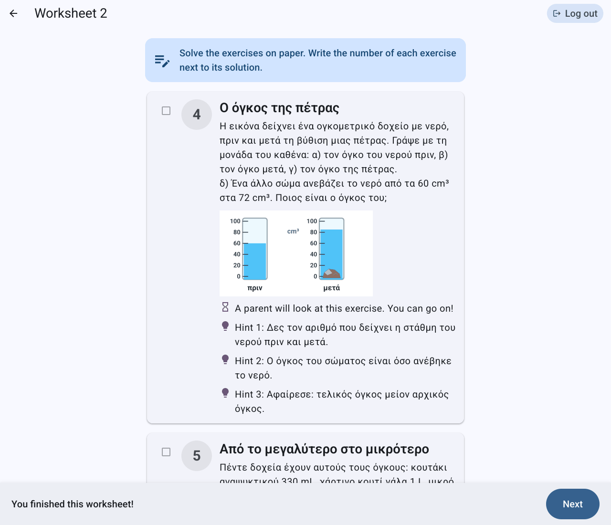

## 5. The parent afterwards

### 5.1 Exercises waiting for you

When you log in and some exercises are waiting for you (the child used all the tries without a pass), a notice lists them: the child, the cassette, and the number and title of each exercise. **Review now** opens the review queue; **Later** closes the notice, and the **Progress** tile still shows the number. The notice appears every time you log in while something is waiting.

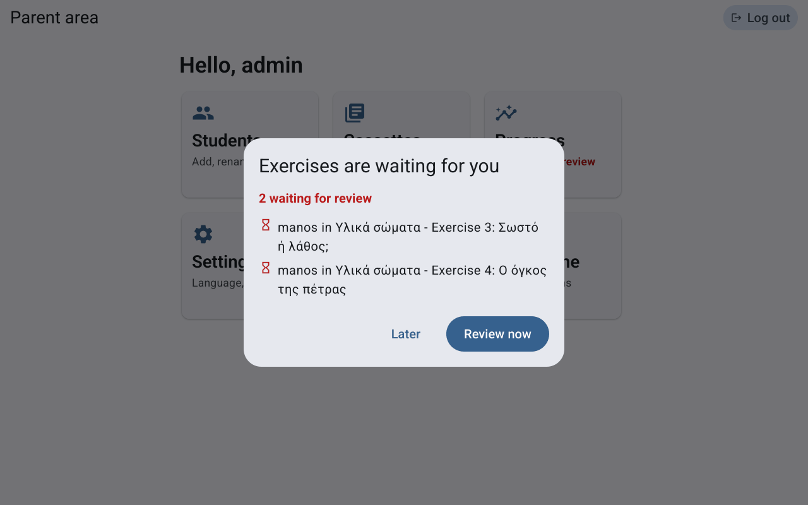

### 5.2 Progress

Open **Progress**, then pick a child and a cassette. The page of a cassette shows, from the top:

- **Waiting for you**: the exercises that need your decision, with **Mark passed** and **Reset attempts** (give the child new tries);
- two switches for this child and cassette: **Skip lessons** (the child can go on without finishing the lessons) and **Free navigation** (every lesson and exercise is open, for example to revise);
- every lesson and exercise in order, with its state, the tries used, the hints shown and the dates, and buttons to change them: **Mark completed** or **Mark not completed** for a lesson, **Mark passed** or **Mark not passed** and **Reset attempts** for an exercise;
- the **photos that were sent**, newest first: the time, the exercises, the provider and its kind, and the status; and, at the very bottom, a **Reset all progress** button for this cassette. The page of the child (before you pick the cassette) also has **Delete all photos** for that child.

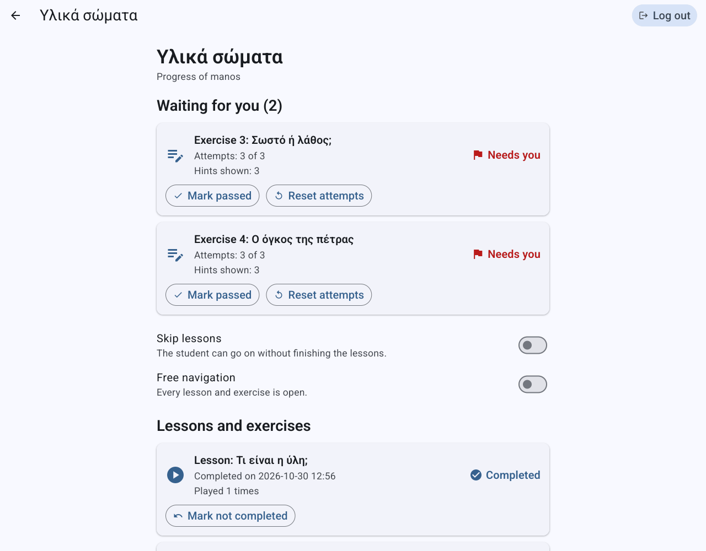

### 5.3 A submission: the photo, the AI's verdicts and the notes for you

Open one of the sent photos to see everything about one check: the status and which provider and model were used; the **photos** (tap one to see it full size); **notes on the whole page** by the AI; and, for each exercise, the verdict, **what was read** from the paper, **what the child was told**, and **notes for you**, which are written for parents and say why the AI gave that verdict. Next to each exercise you have the override buttons. **Delete photos** removes the photos of this check but keeps the results.

This is a real check of four exercises. Look at exercise 4: the AI marked it "unreadable" because some digits were written over others, and told the child so and asked for a clearer photo; it explains this to you in the notes, and the exercise is one of those waiting for you. Reading the notes tells you what happened, and you decide.

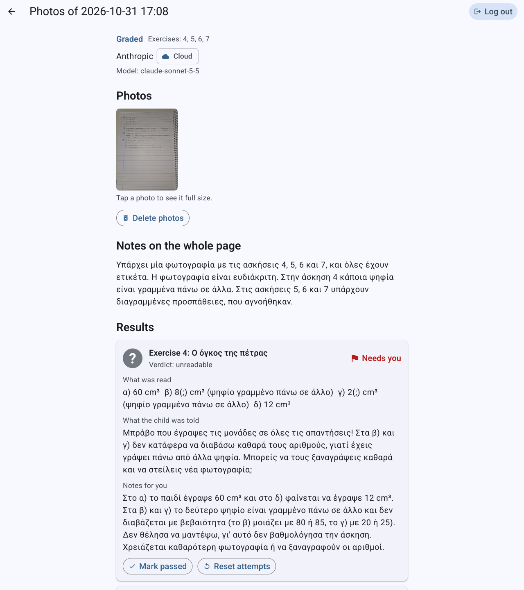

The full-size photo can be zoomed to read the handwriting yourself:

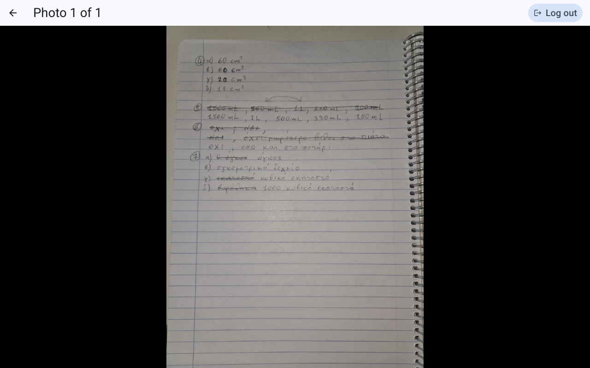

### 5.4 The review screen

**Review now** (and the review button of the Progress screen) opens a queue of the waiting exercises, oldest first. Each shows the child and the cassette, the question, the **reference solution** (hidden until you press **Show the reference solution**) and every try that did not pass, newest first: the date, the photos, the verdict, what was read, what the child was told, and the notes for you.

Two buttons decide it:

- **Pass** marks the exercise as passed by you. It leaves the queue and the next items stay unlocked.
- **Give more attempts** resets the tries (after a confirmation) and the child will have to solve the exercise before going further.

When the queue is empty the screen says "Nothing is waiting".

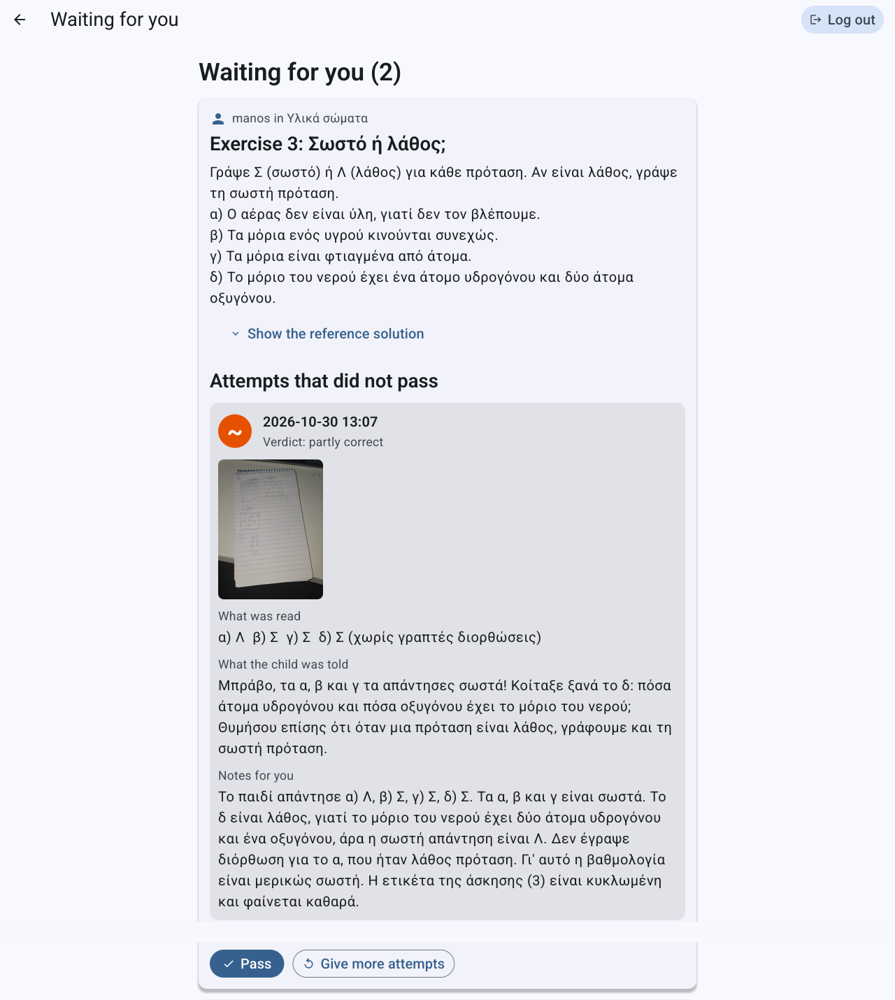

### 5.5 Play as me

**Play as me** on the home screen opens the shelf as a student would see it, with your own progress, which is kept separately like a child's. Use it to watch a new cassette before your child does.

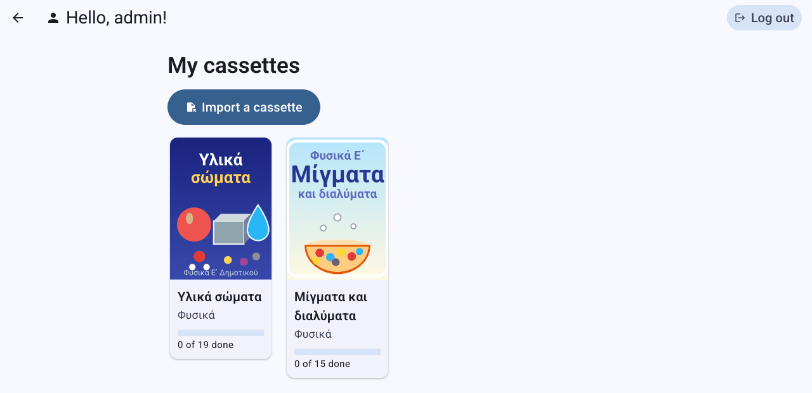

## 6. Troubleshooting and tips

- **The phone cannot open the page.** The phone must be on the same network as the computer (not a guest network that isolates devices). Type the address that is shown under the QR code. Open the port as described in [section 2.8](#28-let-the-phone-reach-the-computer) (on Windows, allow Radio Tutor on private networks). If the computer has several networks, choose the right one in Settings, "Network interface for the phone page". "This computer is not connected to a network" means no private address was found. If the port is taken by another program, choose another one in Settings.
- **"This link has expired."** The link ends when the child logs out, when Radio Tutor is closed, or after an hour without photos. Press **Check my answers** again and scan the new code.
- **The exercises cannot be checked.** An AI provider has to be active. Open **AI providers**, press **Test**, fix the address, key or model, and press **Set active**. For a local provider, make sure the program (for example Ollama) is running. The child sees only a short message ("The checker could not answer. Try again."); you see the details on the Progress screen and in the log.
- **"The checker could not answer."** The child can press **Try again**. If it keeps failing, test the provider as above.
- **No sound.** The lesson shows "No sound device found. The lesson plays without sound." On Linux, check that PulseAudio, or PipeWire with `pipewire-pulse`, is running in your desktop session, and start the app again. The speaker button and **Settings** also have a mute that you may have turned on.
- **The file chooser does not open on Linux.** Importing needs a desktop file dialog (xdg-desktop-portal with a backend for your desktop).
- **"Radio Tutor is already running."** Only one copy can run. Close the other one.
- **A forgotten password.** A parent can reset a child's password in **Students**, with the key icon. If you forget the only parent's password, close the program and run `radio-tutor reset-password <username>` in a terminal.
- **Handwriting the AI cannot read.** Take photos in good light, flat and from straight above, one page at a time, with the number of each exercise written clearly next to its solution; don't write over crossed-out answers. A cloud model or a larger local model usually reads handwriting better.
- **Privacy.** The photos stay in the program's data folder until you delete them (per check, or all of a child's photos). Back up by closing Radio Tutor and copying its folders; the [README](../README.md#where-the-data-lives) says where they are. A backup holds API keys, password hashes and photos of the children's paper, so keep it private.

More details, including the Windows specifics, are in the [README](../README.md); the full cassette format is in [CASSETTE-FORMAT.md](CASSETTE-FORMAT.md) and the prompt for the AI agent is in [CASSETTE-AUTHORING-PROMPT.md](CASSETTE-AUTHORING-PROMPT.md).
